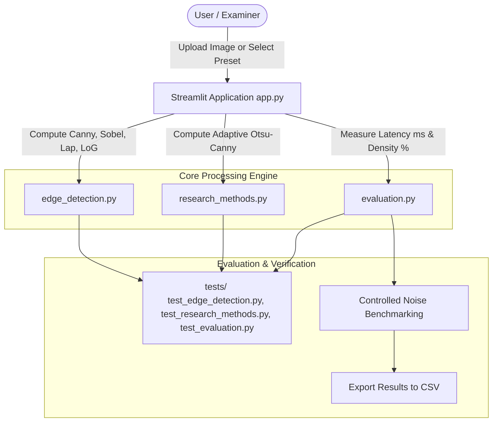

# Edge Detection Tool: Comparative Analysis & Research-Based Implementation

[](https://www.python.org/)
[](https://opencv.org/)
[](https://streamlit.io/)
[](https://pytest.org/)
[](https://doi.org/10.3233/ATDE240501)

> **College Project Title:** *“Edge Detection Tool: Comparative Analysis and Research-Based Implementation of Canny, Sobel, and Laplacian Edge Detection.”*  
> **Reference Research Paper:** *Performance Investigating of Several Classical Edge Detection Operator for Segmentation* (Sun & Shakhor, 2024).

---

## 1. Project Overview & Objectives

In computer vision and digital image segmentation, edge detection identifies sharp discontinuities in image brightness, capturing key structural boundaries while reducing redundant pixel data. 

While classical detectors like Sobel, Laplacian, and Canny are foundational, each suffers from distinct operational limitations:
- **First-order operators (Sobel, Prewitt, Roberts):** Produce thick, unthinned edges and require manual binarization.
- **Second-order operators (Laplacian):** Highly sensitive to noise due to double spatial differentiation, frequently generating spurious zero-crossings.
- **Multi-stage Canny:** Produces optimal, single-pixel thin contours, but requires manual tuning of two hysteresis thresholds ($T_{low}, T_{high}$).

### Core Objectives
1. Implement independent, reusable Python modules for **Canny**, **Sobel**, **Laplacian**, and **Laplacian of Gaussian (LoG)**.
2. Investigate and implement an **Otsu-Canny Variant (Paper-Inspired)** referencing Sun & Shakhor (2024) to automate threshold selection.
3. Provide an interactive web dashboard using **Streamlit** for real-time visualization, parameter experimentation, and CSV data export.
4. Provide a full suite of automated unit tests using **pytest**.
5. Document theory, proofs, and viva voce questions for college laboratory examinations.

---

## 2. Research Paper Reference & Integrity Statement

### Citation
- **Title:** *Performance Investigating of Several Classical Edge Detection Operator for Segmentation*
- **Authors:** Lei Sun and Shariar Shakhor
- **Year:** 2024
- **Proceedings:** *Advances in Transdisciplinary Engineering*, Vol. 50, pp. 497–506
- **DOI Link:** [https://doi.org/10.3233/ATDE240501](https://doi.org/10.3233/ATDE240501)

### Methodology & Provenance
Sun & Shakhor (2024) studied classical edge operators for segmentation and analyzed Canny's sensitivity to empirical thresholding. They evaluated using Otsu's maximum inter-class variance to adaptively calculate edge thresholds.

**Integrity Disclosure:**
- **Verified Theory:** The principle of using Otsu's discriminant criterion $t^* = \arg\max \sigma_B^2(t)$ to remove subjective manual Canny thresholding is faithfully integrated.
- **Paper-Inspired Approximation:** Because closed-form empirical scaling coefficients for proprietary conference datasets are not publicly standardized, our implementation is explicitly labelled **“Otsu-Canny Variant (Paper-Inspired)”** using the standard hysteresis relation $T_{high} = T_{otsu}$ and $T_{low} = \alpha \cdot T_{otsu}$ (default $\alpha = 0.5$). An additional **Gradient-Domain Otsu-Canny** is provided as a research extension.

---

## 3. System Architecture



---

## 4. Project File Structure & Descriptions

```
edge-detection-tool/
├── app.py                      # Main Streamlit web application with 5 comprehensive tabs
├── edge_detection.py           # Core implementations of Canny, Sobel, Laplacian, LoG, Prewitt, Roberts
├── research_methods.py         # Research paper implementation: Otsu thresholding & Otsu-Canny variants
├── evaluation.py               # Latency profiling, edge density %, ground-truth metrics, and noise models
├── generate_samples.py         # Utility script to generate synthetic benchmark images
├── requirements.txt            # Python dependencies (OpenCV, NumPy, Streamlit, Matplotlib, Pandas, pytest)
├── README.md                   # Full setup, run guide, and algorithm documentation
├── research_report.md          # 15-section academic college project report
├── .gitignore                  # Git ignore rules for virtual environments and artifacts
├── sample_images/              # Bundled synthetic test images (geometric shapes, circles, step boxes)
│   ├── geometric_shapes.png
│   ├── concentric_circles.png
│   └── box_step_edge.png
├── results/                    # Directory for exported CSV benchmarks and figures
│   └── .gitkeep
└── tests/                      # Automated unit test suite (17 passed tests)
    ├── test_edge_detection.py
    ├── test_research_methods.py
    └── test_evaluation.py
```

### File Purposes
- **`edge_detection.py`**: Pure, decoupled OpenCV/NumPy functions. No UI or network dependencies. Uses `cv2.CV_64F` to prevent arithmetic overflow in differential calculations.
- **`research_methods.py`**: Contains `compute_otsu_threshold`, `otsu_canny_paper_inspired`, and `gradient_otsu_canny` with theoretical documentation.
- **`evaluation.py`**: Implements timing via `time.perf_counter()`, density metrics, and reproducible Gaussian/Salt-and-Pepper noise injection.
- **`app.py`**: Multi-tab Streamlit dashboard offering controls, comparisons, histograms, and CSV downloads.
- **`research_report.md`**: Formal academic submission report formatted for university evaluation.

---

## 5. Technology Stack

- **Python:** Version 3.11 (compatible with 3.10+)
- **OpenCV (`opencv-python-headless`):** Fast spatial convolutions, Gaussian blurs, and Sobel/Laplacian kernels
- **NumPy:** Numerical matrix calculations, vectorization, and zero-crossing detection
- **Streamlit:** Interactive web UI with real-time reactive parameter tuning
- **Matplotlib:** Intensity histogram plots showing Otsu threshold placement
- **Pandas:** Tabular evaluation dataframes and CSV export
- **Pillow:** Image decoding and format serialization
- **pytest:** Automated test execution

*Note: The project executes 100% locally on your computer. It requires no Gemini API key or external cloud inference.*

---

## 6. Installation & Setup Guide

### A. Windows Installation

#### Using Command Prompt (`cmd.exe`):
```cmd
# 1. Clone or navigate to the project directory
cd edge-detection-tool

# 2. Create a Python virtual environment
python -m venv venv

# 3. Activate the virtual environment
venv\Scripts\activate.bat

# 4. Upgrade pip and install dependencies
python -m pip install --upgrade pip
pip install -r requirements.txt

# 5. Generate sample benchmark images
python generate_samples.py
```

#### Using Windows PowerShell:
```powershell
# 1. Navigate to project
cd edge-detection-tool

# 2. Create virtual environment
python -m venv venv

# 3. Enable script execution (if restricted) and activate
Set-ExecutionPolicy -ExecutionPolicy RemoteSigned -Scope Process
.\venv\Scripts\Activate.ps1

# 4. Install dependencies
pip install -r requirements.txt

# 5. Generate sample images
python generate_samples.py
```

### B. Linux / macOS Installation

```bash
# 1. Navigate to directory
cd edge-detection-tool

# 2. Create and activate virtual environment
python3 -m venv venv
source venv/bin/activate

# 3. Install dependencies
pip install --upgrade pip
pip install -r requirements.txt

# 4. Generate sample images
python3 generate_samples.py
```

---

## 7. Running the Application & Tests

### Launch the Streamlit Dashboard
```bash
streamlit run app.py
```
*The app will automatically open in your default browser at `http://localhost:8501`.*

### Run Automated Tests
```bash
pytest tests/ -v
```
*Expected output: All 17 unit tests passing in < 0.5s.*

---

## 8. Dashboard Walkthrough (Tabs)

1. **Tab 1: Overview**
   - Introduces core concepts, mathematical formulas, and pipeline flowcharts.
2. **Tab 2: Edge Detection**
   - Upload any custom JPG/PNG image or select built-in sample presets.
   - Choose an operator and tune parameters (kernel aperture, sigma, hysteresis thresholds).
   - Side-by-side display of original vs. edge output.
   - Real-time diagnostic cards: Execution Latency (ms), Edge Pixel Density (%), and Resolution.
   - One-click PNG image download.
3. **Tab 3: Research Paper Implementation**
   - Detailed analysis of Sun & Shakhor (2024) [DOI: 10.3233/ATDE240501].
   - Direct side-by-side comparison of **Manual Canny** vs. **Otsu-Canny Variant**.
   - Matplotlib histogram visualizing Otsu's threshold cut-off against the image's pixel distribution.
4. **Tab 4: Experiments & Evaluation**
   - Synchronous multi-algorithm benchmark running all detectors on the exact same input image.
   - Benchmark summary table with pandas.
   - Bar chart of execution latencies.
   - Controlled noise stress test: Inject Gaussian or Salt-and-Pepper noise and compare filter degradation.
   - One-click CSV export of experiment data.
5. **Tab 5: About and Viva Preparation**
   - 10 comprehensive viva voce technical questions and answers designed for college defense.

---

## 9. Theoretical Summary of Algorithms

### 1. Sobel Operator
- **Type:** Discrete first-order gradient operator.
- **Kernels ($3 \times 3$):**
  $$K_x = \begin{bmatrix} -1 & 0 & 1 \\ -2 & 0 & 2 \\ -1 & 0 & 1 \end{bmatrix}, \quad K_y = \begin{bmatrix} -1 & -2 & -1 \\ 0 & 0 & 0 \\ 1 & 2 & 1 \end{bmatrix}$$
- **Combined Magnitude:** $G = \sqrt{G_x^2 + G_y^2}$.
- **Numerical Note:** Evaluated in `CV_64F` to prevent 8-bit wrap-around before normalizing to $[0, 255]$.

### 2. Laplacian Operator
- **Type:** Isotropic second-order spatial derivative.
- **Formulation:** $\nabla^2 f = \frac{\partial^2 f}{\partial x^2} + \frac{\partial^2 f}{\partial y^2}$.
- **Kernel ($3 \times 3$):**
  $$K = \begin{bmatrix} 0 & 1 & 0 \\ 1 & -4 & 1 \\ 0 & 1 & 0 \end{bmatrix} \quad \text{or} \quad \begin{bmatrix} 1 & 1 & 1 \\ 1 & -8 & 1 \\ 1 & 1 & 1 \end{bmatrix}$$
- **Sensitivity:** High-pass nature heavily amplifies noise.

### 3. Laplacian of Gaussian (LoG)
- **Type:** Second-order derivative with Gaussian regularizer.
- **Steps:** 
  1. Convolve with Gaussian filter $G_\sigma(x, y)$ of scale $\sigma$.
  2. Compute Laplacian $\nabla^2$.
  3. Detect zero-crossings where adjacent pixels change sign and exceed sensitivity threshold.

### 4. Canny Edge Detector
- **Type:** Multi-stage optimal detector.
- **Stages:**
  1. Gaussian pre-blurring.
  2. Directional gradient computation ($G_x, G_y$).
  3. Non-Maximum Suppression (thins edges to 1 pixel).
  4. Double thresholding ($T_{low}, T_{high}$).
  5. Hysteresis tracking via 8-connectivity.

---

## 10. Viva Voce Quick Revision Guide

1. **Why does higher edge pixel percentage not mean higher accuracy?**  
   *Answer:* It measures edge density, not correctness. An unblurred Laplacian on a noisy image triggers on random noise, giving $>30\%$ edge pixels with poor semantic quality. Canny gives $\approx 3-5\%$ clean, true boundary pixels.
2. **Why use CV_64F for Sobel?**  
   *Answer:* Gradients can be negative ($-255$) and magnitudes can exceed $255$. Calculating in `uint8` causes arithmetic wrap-around (e.g. $-1 \rightarrow 255$), destroying edges.
3. **What is the mathematical goal of Otsu's method?**  
   *Answer:* To maximize between-class variance $\sigma_B^2(t) = \omega_0(t)\omega_1(t)(\mu_0(t) - \mu_1(t))^2$, which is mathematically equivalent to minimizing within-class variance.

---

## 11. Known Limitations

- **Otsu Bimodality:** Images with unimodal histograms or continuous gradients may lead to inappropriate Otsu thresholds.
- **Global Thresholding:** Global Otsu does not adapt to localized lighting shadows; local block-based adaptive methods can be explored in future work.
